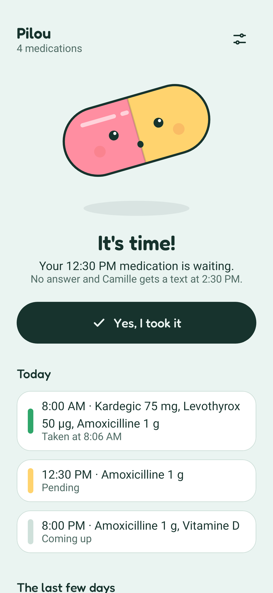

<p align="center"></p>

# Pilou

A silent medication reminder for Android, in English and French. At each dose,
a notification asks whether it was taken. If nobody confirms in time,
the app texts a contact. Several medications, each with its own times, days and end date.

No account, no internet access, no cloud backup.

<p>



</p>

## Install

Download the APK from [Releases](https://github.com/mathieuorhan/pilou/releases),
or add this repository to [Obtainium](https://github.com/ImranR98/Obtainium) to get updates.

### Beta

The latest [release](https://github.com/mathieuorhan/pilou/releases) named "Beta" is the
development version. It installs as a separate app, Pilou β, so the stable app stays as it is.
It may be broken: don't rely on it for an actual medication.

To get its updates in Obtainium, add this repository again with "Include prereleases" on
and "Filter release titles by regular expression" set to `^Beta`.

## Build

```sh
./gradlew testDebugUnitTest
./gradlew assembleRelease
```

## License

Apache-2.0. Font: [Fredoka](https://github.com/hafontia/Fredoka-One), SIL Open Font License 1.1.
