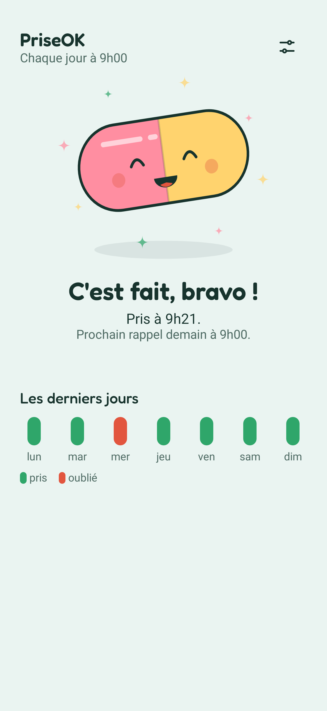
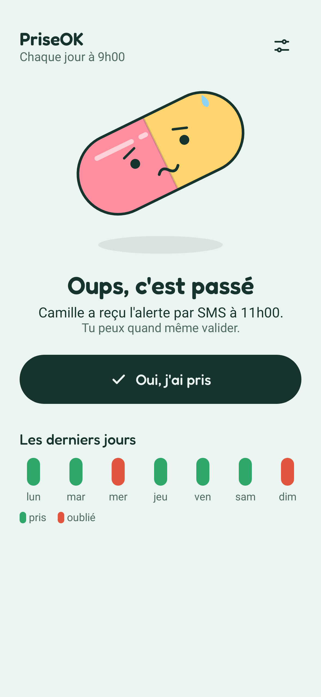
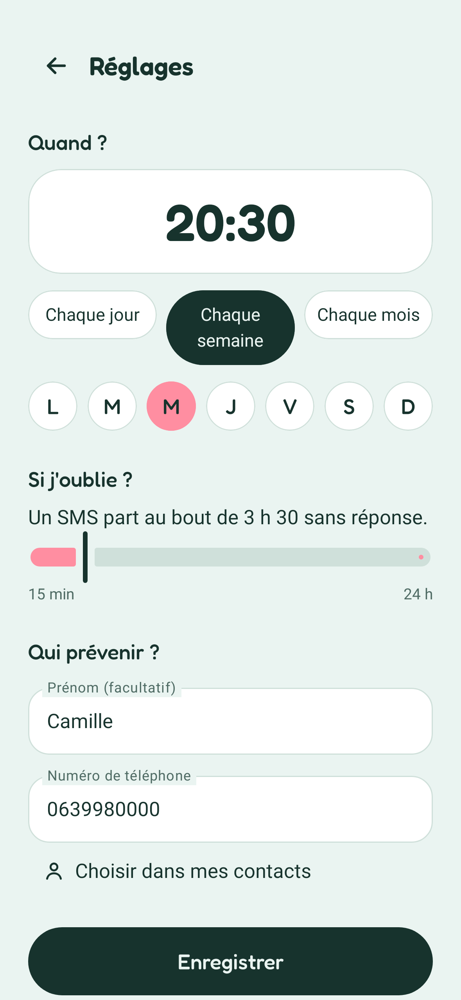

# PriseOK

A silent medication reminder for Android. At the chosen time, a notification asks
« As-tu pris ton médicament ? » with a **Oui, j'ai pris** button. If nobody confirms
within the chosen delay, the app texts a contact:
« Attention ! Ton contact n'a pas pris son médicament. »

No account, no internet permission, no cloud backup, no tracking. Apache-2.0.

<p>




</p>

## How it works

| Piece | File |
|---|---|
| Pure scheduling logic (next reminder, deadline, which dose the button confirms, late SMS after a reboot) | `app/src/main/java/fr/priseok/app/core/Schedule.kt` |
| Home screen states and French wording | `core/Home.kt`, `core/Wording.kt` |
| Exact alarms: at most two pending (next reminder, SMS deadline) | `Alarms.kt` |
| Reminder, deadline, notification button, reboot | `Receivers.kt` |
| Silent notification channel | `Notifier.kt` |
| SMS sending and delivery result | `Sms.kt` |
| Settings and history (SharedPreferences) | `Store.kt` |
| UI (Jetpack Compose) and the capsule mascot | `ui/` |

Rules:
- Frequency: daily, weekly (one weekday) or monthly (day 1–31; shorter months use their last day).
- Delay before the SMS: 15 min to 24 h (23 h 45 for daily, so it never overlaps the next reminder).
- The button confirms the upcoming dose if it is less than 3 h away, otherwise the latest one.
- A dose scheduled before the settings were saved is ignored (no SMS for a reminder that never fired).
- If the phone was off at the deadline, the SMS is sent at startup, unless the deadline is more than 12 h old.
- The SMS is sent at most once per dose.
- Times follow the wall clock across daylight saving time; the delay is a real duration.

## Install

- **Obtainium** (gets updates automatically): add app → `https://github.com/mathieuorhan/priseok`.
- **APK**: download it from [Releases](https://github.com/mathieuorhan/priseok/releases).
- On Android 13+, an APK installed by hand needs "Allow restricted settings" (app info → ⋮) before the SMS permission can be granted.

## Build

Requirements: JDK 17+, Android SDK (platform 35, build-tools 35).

```sh
echo "sdk.dir=/path/to/android-sdk" > local.properties
./gradlew testDebugUnitTest    # 40 tests + screenshots in app/build/screenshots
./gradlew assembleRelease      # unsigned unless KEYSTORE_FILE and KEYSTORE_PASSWORD are set
```

To sign locally: `KEYSTORE_FILE=/path/priseok-release.jks KEYSTORE_PASSWORD=... ./gradlew assembleRelease` (key alias `priseok`).
Always sign with the same key, or Android refuses to install updates over the existing app.

## Releasing

1. Bump `versionCode` and `versionName` in `app/build.gradle.kts`, add `fastlane/metadata/android/*/changelogs/<versionCode>.txt`.
2. Push to `main`. The [build workflow](.github/workflows/build.yml) runs the tests, builds and signs the APK, and,
   if that version has no release yet, publishes release `v<versionName>` with `PriseOK-<versionName>.apk`.

Pull requests get the tests and an unsigned build, never the signing key.

Repository secrets (Settings → Secrets and variables → Actions):
- `KEYSTORE_B64`: the signing keystore, base64.
- `KEYSTORE_PASSWORD`: its password (store and key share it).

## Tests

- `ScheduleTest`, `HomeTest`, `WordingTest`: pure JVM tests of the logic (DST, month ends, deadlines, late SMS, no duplicate SMS).
- `ReceiversTest` (Robolectric): the real receivers with fake SMS, alarms and notifications.
- `ScreenshotTest` (Roborazzi): renders every screen state to PNG.

Manual checklist on a real phone before handing it over:
1. Set the delay to 15 min and a time 2 min ahead; check the silent notification arrives.
2. Tap « Oui, j'ai pris » in the notification; check no SMS goes out.
3. Next cycle, do nothing; check the SMS arrives after 15 min.
4. Reboot the phone between the reminder and the deadline; check the SMS still goes out.
5. « Tester le SMS » in the settings with the real contact number.
6. On Xiaomi, Samsung, Huawei, OnePlus: allow the app to run in the background (see https://dontkillmyapp.com).

## Publish on F-Droid

1. Make sure release `v1.0.0` exists (the workflow creates the tag).
2. Fork https://gitlab.com/fdroid/fdroiddata and copy `fdroid/fr.priseok.app.yml` to `metadata/`.
3. Open a merge request. Review and first build usually take a few weeks.
   Guide: https://f-droid.org/docs/Submitting_to_F-Droid_Quick_Start_Guide/

Store texts, icon and screenshots are in `fastlane/metadata/android/`, where F-Droid reads them.

## License

Apache-2.0, see `LICENSE`.

## Credits

Font: Fredoka by The Fredoka Project Authors, SIL Open Font License 1.1 (`FONT-LICENSE-OFL.txt`).
