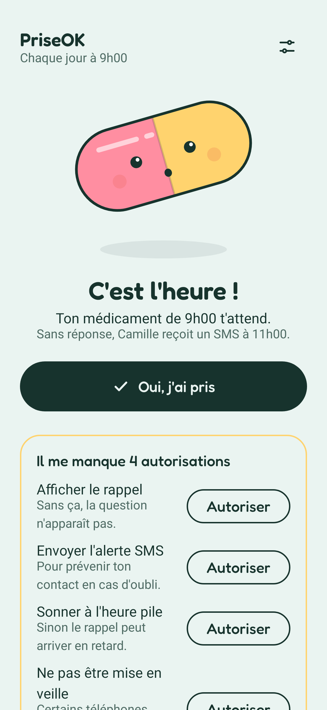
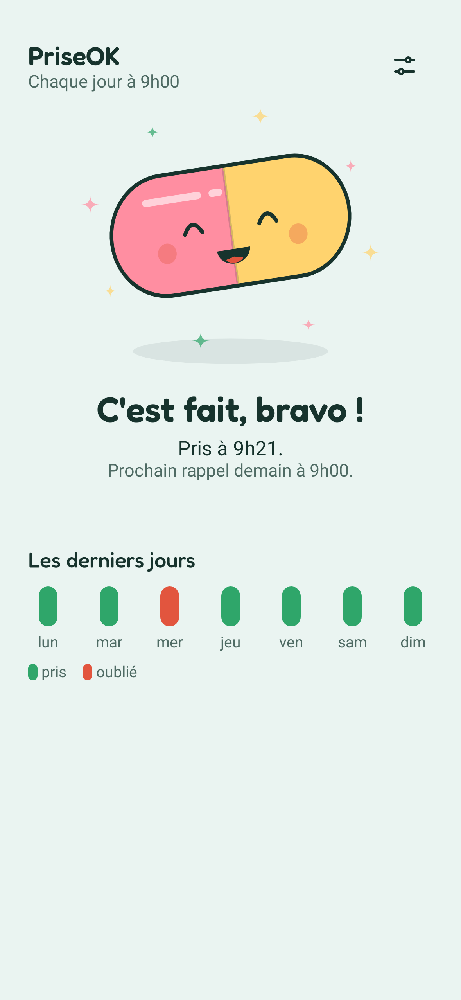
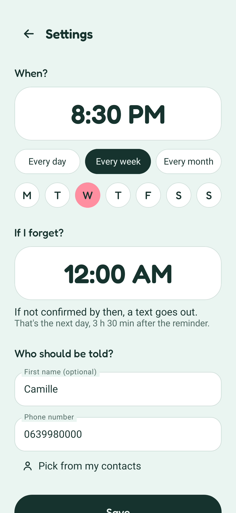

<p align="center"></p>

# PriseOK

A silent medication reminder for Android, in English and French. At the chosen time,
a notification asks whether the medication was taken. If nobody confirms in time,
the app texts a contact.

No account, no internet access, no cloud backup.

<p>




</p>

## Install

Download the APK from [Releases](https://github.com/mathieuorhan/priseok/releases),
or add this repository to [Obtainium](https://github.com/ImranR98/Obtainium) to get updates.

## Build

```sh
./gradlew testDebugUnitTest
./gradlew assembleRelease
```

## License

Apache-2.0. Font: [Fredoka](https://github.com/hafontia/Fredoka-One), SIL Open Font License 1.1.
